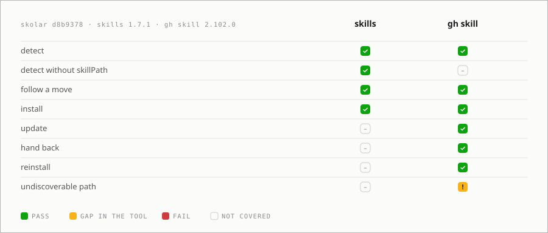
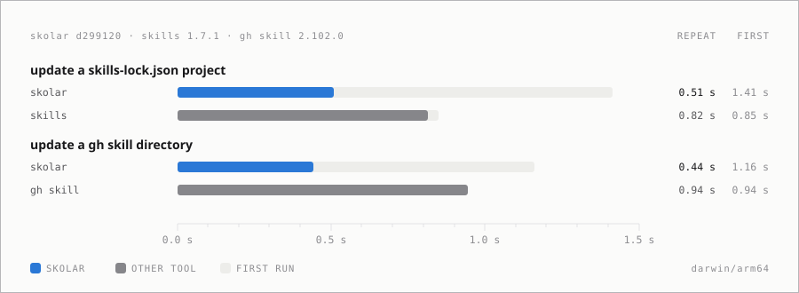

# skolar

Manage local [agent skills](https://agentskills.io) from git repos.
Reads and writes both [vercel-labs/skills](https://github.com/vercel-labs/skills) lockfiles and [`gh skill`](https://cli.github.com/manual/gh_skill) metadata.


## Why

- Version-control skills from external repositories, say in your dotfiles
- Selectively install only the skills you need
- See which skills changed, moved, or disappeared upstream before applying

## Install

Install with [mise](https://mise.en.dev):

```sh
mise use -g packslip:github.com/h3y6e/skolar
```

Or with `go install`:

```sh
go install github.com/h3y6e/skolar@latest
```

Or download a binary from [Releases](https://github.com/h3y6e/skolar/releases).

## Usage

```sh
skolar add h3y6e/spec-skills                 # latest release, else default branch
skolar add h3y6e/spec-skills#main            # pin a ref
skolar add -s 'spec-*' h3y6e/spec-skills     # only some skills
skolar add -d dot_agents/exact_skills ...    # another directory (default .agents/skills)
skolar list
skolar update                                # review what changed upstream, then confirm
skolar verify                                # check files on disk against the record
skolar remove spec-plan
```

## Formats

skolar records each skill in `gh skill` metadata in its `SKILL.md`, so `gh skill` manages it too. Beside a `skills-lock.json`, `.agents/skills` keeps using the lockfile, so vercel-labs/skills manages it too.

## Interop

### Compatibility



### Benchmark



## License

[MIT](LICENSE)
