# skolar

Manage local [agent skills](https://agentskills.io) from git repos.
Reads and writes both [vercel-labs/skills](https://github.com/vercel-labs/skills) lockfiles and [`gh skill`](https://cli.github.com/manual/gh_skill) metadata.



## Why

- Version-control skills from external repositories, say in your dotfiles
- Selectively install only the skills you need
- See which skills changed, moved, or disappeared upstream before applying

## Install

Install with [mise](https://mise.en.dev):

```sh
mise use -g packslip:github.com/h3y6e/skolar
```

Or with `go install`:

```sh
go install github.com/h3y6e/skolar@latest
```

Or download a binary from [Releases](https://github.com/h3y6e/skolar/releases).

## Usage

```sh
skolar add h3y6e/spec-skills                  # latest release, else default branch
skolar add h3y6e/spec-skills#main             # pin a ref
skolar add -s spec-plan h3y6e/spec-skills     # only some skills
skolar add -d dot_agents/exact_skills ...     # other directory (default .agents/skills)
skolar list
skolar update --dry-run                       # changes upstream, by source
skolar update                                 # then confirm
skolar verify                                 # files on disk match the record
skolar remove spec-plan
```

- Without `-s`, `add` installs the skills vercel-labs/skills or `gh skill` finds by default; `-s` reaches any directory with a `SKILL.md`.
- `-s` and `remove` take globs, e.g. `skolar remove 'gke-*'`.
- `add`, `update`, and `remove` take `--dry-run`, and confirm before overwriting or deleting; pass `-y` without a TTY.
- `update` lists only changed skills: `M` changed, `R` moved (followed), `D` removed upstream (kept), `A` not installed (counted; `--json` names them), `!` unchecked.
- `list --json` and `update --json` print `{"skills": [...]}` and `{"results": [...]}`, plus `"error": {"code", "message", "fix"}` on failure.
- Fetched repositories are cached in the user cache directory, e.g. `~/.cache/skolar`, so later runs fetch only what changed upstream.
- Any flag except `--help` and `--version` can be set as `SKOLAR_<FLAG>`, e.g. `SKOLAR_DIR`.
- Exit status: 0 success, 1 failure (including a skill that could not be checked), 2 usage error or missing `-y`.

## Formats

skolar records each skill in `gh skill` metadata in its `SKILL.md`, in any directory, so skills installed by either tool are managed by both. In a project with a `skills-lock.json`, `.agents/skills` keeps using the lockfile so vercel-labs/skills still works. Non-GitHub sources need the lockfile, so they can only be added to `.agents/skills`.

Each format installs the files its tool would, except that a link leading out of the repository is never followed.

In `gh skill` format:

- Without `#ref`, `update` follows the highest non-prerelease semver tag.
- With `#ref`, the skill is pinned and `update` skips it; re-add to move the pin.
- Skills installed with `gh skill install --from-local` can be listed and removed, not updated.

## License

[MIT](LICENSE)
